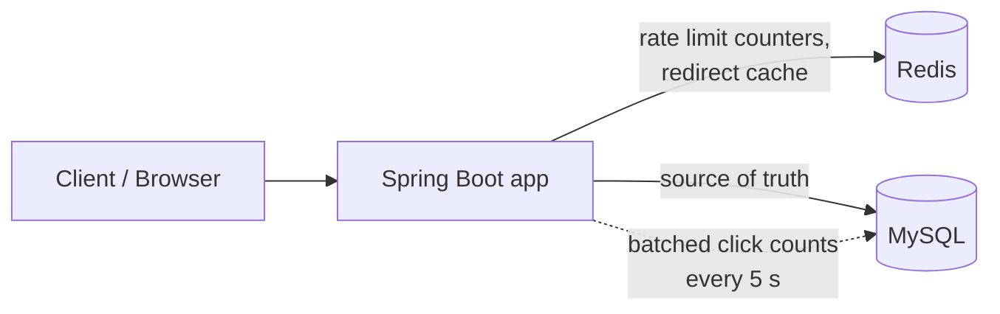
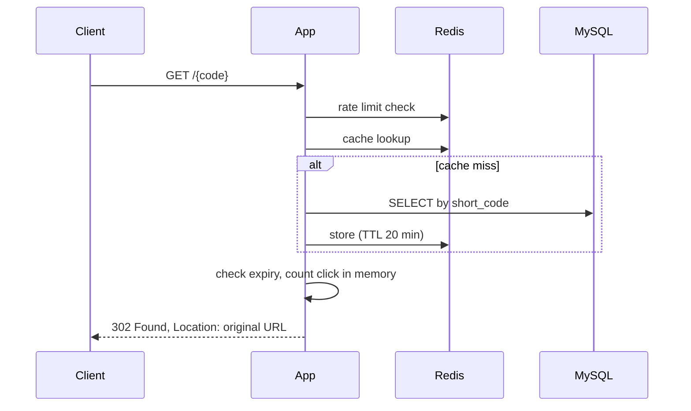

# Design Document: URL Shortener

This document explains how the service is designed, why, and how it would scale beyond a single instance. Sections 1–6 describe what is implemented in this repository. Sections 7–9 are analysis and are not implemented.

## 1. Requirements

**Functional**
- Create a short link for a long `http(s)` URL
- Optional custom alias and optional expiry
- Redirect a short code to the original URL
- Per-link click statistics

**Non-functional**
- Redirects must be fast (read path is the hot path)
- Short codes must not be guessable in sequence
- Redirects should keep working if the cache is down
- Protect the create and read endpoints from abuse

**Out of scope (for now):** user accounts, link editing/deletion, per-click analytics (country, device, referrer).

## 2. Architecture

The app is stateless apart from a small in-memory click buffer, so several instances can run behind a load balancer.

### Redirect request flow

## 3. Data Model

One table, `url_mapping`, managed by Flyway (Hibernate only validates the schema).

| Column | Notes |
|--------|-------|
| `id` | Primary key |
| `short_code` | **Unique index**, the lookup key for every redirect |
| `original_url` | The target |
| `created_at`, `expires_at` | `expires_at` is nullable |
| `click_count` | Updated in batches |

The unique index on `short_code` is both the redirect lookup path and the final guard against two requests claiming the same code at the same time (the loser gets `409`).

## 4. Key Design Decisions

### 4.1 Short code generation: random Base62

Each code is 7 random characters from `[0-9a-zA-Z]`, generated with `SecureRandom`. That gives 62^7, about 3.5 trillion codes. On collision the service retries, up to 5 times.

| Approach | Pros | Cons |
|----------|------|------|
| **Random Base62 (chosen)** | Not guessable, no coordination between instances | Needs a uniqueness check and retry |
| Counter encoded in Base62 | No collisions, short codes | Sequential, so links can be enumerated; counter is a shared bottleneck |
| Hash of the URL (MD5/SHA, truncated) | Same URL gives same code | Truncation causes collisions; hard to support custom expiry per link |
| Pre-allocated ID ranges per server | No collisions, scales out | More moving parts (range allocator) |

Collision odds stay low. With 6 billion links stored, only about 0.17% of the code space is used, so roughly 1 in 600 attempts needs a retry.

### 4.2 Redirect status: 302, not 301

A 301 is cached by browsers, so repeat visits would never reach the server and clicks couldn't be counted. A 302 keeps every click visible at the cost of more traffic. If analytics didn't matter, 301 would cut load considerably.

### 4.3 Read path: cache-aside with Redis

Redirects are read-heavy, so lookups go to Redis first and fall back to MySQL on a miss. Entries have a 20 minute TTL. Expiry is checked on every request using the stored `expires_at`, so a cached link still expires on time.

**If Redis is down,** cache reads and writes are treated as misses and redirects continue from MySQL, just slower.

### 4.4 Click counting: write-behind batching

Writing to MySQL on every redirect would turn a read-heavy workload into a write-heavy one. Instead, clicks are counted in memory and flushed every 5 seconds as one batched `UPDATE`. A failed flush keeps the counts and retries. Because updates are additive increments, multiple app instances can flush without coordinating.

**Trade-off:** if an instance crashes, up to 5 seconds of its click counts are lost. A normal shutdown flushes first. For exact counts, clicks would go through a durable queue (see 7.5).

### 4.5 Rate limiting: per-IP fixed window in Redis

Defaults are 10 creates per minute and 120 reads per minute per IP. Counters live in Redis, so the limit holds across instances. Over the limit returns `429` with `Retry-After`.

| Approach | Notes |
|----------|-------|
| **Fixed window (chosen)** | Simple and cheap. A client can burst up to 2x the limit across a window boundary |
| Sliding window | Smoother, more Redis work per request |
| Token bucket | Allows controlled bursts, slightly more state |

**If Redis is down, the limiter fails open.** Availability is preferred over protection here, and a warning is logged.

Behind a reverse proxy the real client IP comes from forwarded headers. The `prod` profile enables this (`server.forward-headers-strategy=framework`), which should only be used behind a trusted proxy.

### 4.6 Input validation

URLs must use `http` or `https`, have a valid host, stay within a length limit, and must not point back at this service (to prevent redirect loops). Custom aliases are limited to 3–30 characters of letters, digits, `_` and `-`, and a reserved list (`api`, `admin`, `actuator`, ...) is rejected so aliases can't shadow real routes.

## 5. Failure Modes

| Failure | Behaviour |
|---------|-----------|
| Redis down | Redirects served from MySQL; rate limiter fails open |
| MySQL down | Cached links still redirect until their TTL ends; creates and cache misses fail with `500` |
| App instance crash | Up to 5 s of unflushed click counts lost on that instance |
| Two requests claim the same alias | Unique index rejects one; client gets `409` |
| Expired link | `410 Gone`, even if the entry is still cached |

## 6. Known Limitations

- **No negative caching.** Requests for codes that don't exist always reach MySQL. The rate limiter is the only protection against a flood of random codes.
- **Fixed-window bursts** are possible at window boundaries.
- **IP-based limits** treat everyone behind one NAT as a single client.
- **No cleanup job** for expired rows, as far as the current code shows. They stay in the table.
- **Stats are public** for anyone who knows a short code, and there are no user accounts.
- **Single MySQL and single Redis** instance, so no replication or failover.

## 7. Scaling Analysis (not implemented)

### 7.1 Capacity estimate

These numbers are assumptions for discussion.

| Item | Estimate |
|------|----------|
| New links | 100M per month, about 40 per second on average |
| Read:write ratio | 100:1, so about 4,000 redirects per second on average |
| Peak | About 3x average, so roughly 12,000 redirects per second |
| Rows after 5 years | 100M x 60 = 6 billion |
| Storage | About 500 bytes per row, so about 3 TB |
| Redirect bandwidth | 12,000/s x about 500 B, only about 6 MB/s, so bandwidth is not the constraint |
| Cache size | If 10M links are hot at about 300 B each, that's about 3 GB, which fits on one Redis node |

Writes are tiny; **reads and storage** are what grow.

### 7.2 Scaling the read path

- Run multiple stateless app instances behind a load balancer.
- Add MySQL **read replicas** for cache misses.
- Move from a single Redis to a **Redis Cluster**, sharded by short code.
- Consider short-lived edge or CDN caching of redirects. This conflicts with accurate click counts unless clicks are logged at the edge.

### 7.3 Scaling storage

- **Shard by short code** (hash of the code, ideally with consistent hashing) so lookups hit exactly one shard.
- Short codes are random, which spreads load evenly and avoids hot shards. Sequential IDs would concentrate writes on the newest shard.
- Move expired or cold links to cheaper storage, and add a scheduled cleanup job.

### 7.4 Scaling code generation

Random generation with a uniqueness check works across shards but needs a lookup per insert. At very high write rates, a **key generation service** that pre-produces unused codes (or hands out ID ranges to each app instance) removes the retry loop and the cross-shard check.

### 7.5 Scaling analytics

Replace in-memory batching with an **event stream** (for example Kafka): each redirect publishes a click event, and a consumer aggregates into an analytics store. This makes counts durable, and it opens the door to per-click data such as time, country and referrer, without adding load to the redirect database.

### 7.6 Availability

- MySQL primary with automatic failover and replicas in other zones.
- Redis with replicas.
- Health checks and graceful shutdown (already flushes clicks) on the app tier.

## 8. Alternatives Considered

| Decision | Chosen | Alternative | Why |
|----------|--------|-------------|-----|
| Database | MySQL | NoSQL key-value store (DynamoDB, Cassandra) | A KV store fits the lookup pattern and scales out more easily. MySQL was chosen for simplicity, relational constraints and familiarity at this size. At the scale in 7.1 a KV store becomes attractive |
| Cache | Redis | In-process cache (Caffeine) | An in-process cache is faster but per-instance, so hit rates drop and invalidation is harder with several instances |
| Click counts | In-memory batch | Per-click DB write | Per-click writes would multiply database load for little benefit |

## 9. Possible Next Steps

- Authentication and per-user link management
- Negative caching for unknown codes
- Sliding-window or token-bucket rate limiting
- Event-driven click analytics
- Integration tests against real MySQL and Redis (Testcontainers)